# Ocima Ore — Guida all'installazione e all'uso

Ocima Ore è l'applicazione per registrare le **ore di lavoro** per commessa e le **ferie, i permessi, gli straordinari e le malattie** dei dipendenti. Funziona sul computer dell'ufficio e si può usare anche da telefono e tablet collegandosi alla stessa rete Wi-Fi. I dati restano sul computer: non serve internet né un account cloud.

**Indice**

1. [Installazione](#1-installazione)
2. [Primo avvio e password](#2-primo-avvio-e-password)
3. [Guida per il dipendente](#3-guida-per-il-dipendente)
4. [Guida per l'amministratore](#4-guida-per-lamministratore)
5. [Usare l'app da telefono e codice QR](#5-usare-lapp-da-telefono-e-codice-qr)
6. [Dove sono i dati e come fare una copia](#6-dove-sono-i-dati-e-come-fare-una-copia)
7. [Problemi frequenti](#7-problemi-frequenti)

---

## 1. Installazione

1. Fai doppio clic sul file **`Ocima Ore Setup 0.0.0.exe`**.
2. Segui la procedura guidata: puoi **scegliere la cartella di installazione** (di solito va bene quella proposta).
3. Al termine trovi l'icona **Ocima Ore** sul desktop e nel menu Start.
4. Fai doppio clic sull'icona per avviare l'app.

> Windows potrebbe mostrare l'avviso «Windows ha protetto il PC» perché l'installer non è firmato. Clicca **Ulteriori informazioni → Esegui comunque**.

Per aggiornare l'app basta eseguire il nuovo installer: i dati esistenti vengono mantenuti.

---

## 2. Primo avvio e password

Alla schermata iniziale si sceglie il proprio profilo e si inserisce la password.

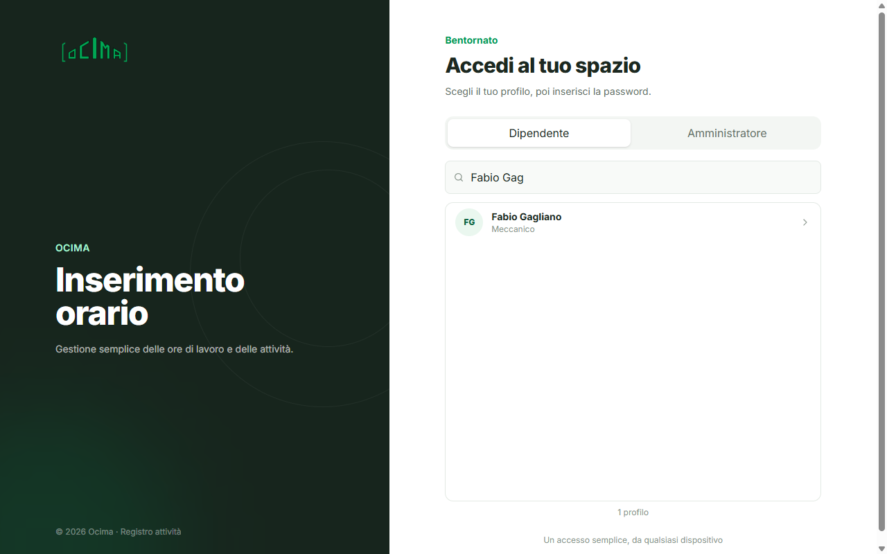

1. Scegli **Dipendente** oppure **Amministratore**.
2. Scrivi le prime lettere del tuo nome nel campo di ricerca e clicca sul tuo profilo.
3. Inserisci la password e premi **Accedi**. L'icona a forma di occhio mostra o nasconde la password.

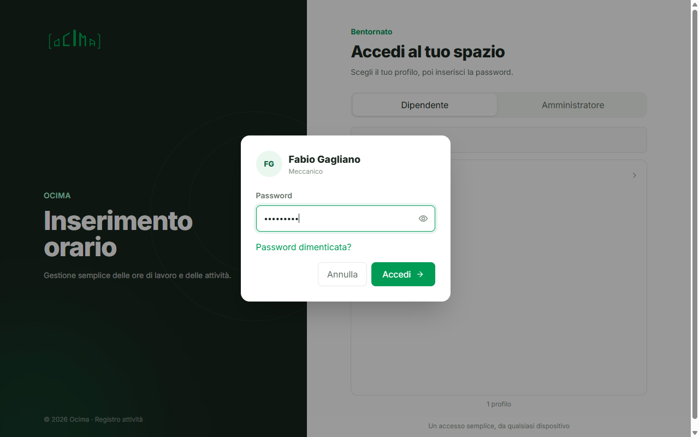

**Password iniziale.** Al primo accesso (e dopo ogni reimpostazione fatta dall'amministratore) si usa la password iniziale, che l'amministratore di sistema trova nel file `.env` (`OCIMA_DEFAULT_PASSWORD`). L'app chiede subito di scegliere una **nuova password personale** (minimo 8 caratteri, diversa da quella iniziale). Puoi cambiarla in qualsiasi momento da **Cambia password**, in basso nel menu a sinistra.

**Password dimenticata?** Nella finestra della password clicca **Password dimenticata?**: l'amministratore riceve la richiesta e può reimpostarla.

---

## 3. Guida per il dipendente

Il menu a sinistra ha tre voci: **Inserisci ore**, **Ferie e straordinari**, **Riepilogo**.

### 3.1 Inserisci ore

Qui registri le ore lavorate.

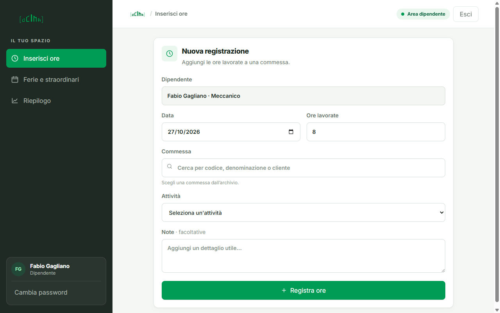

1. **Data** e **Ore lavorate**: la data proposta è oggi (le ore vanno da 0,5 a 24).
2. **Commessa**: scrivi il codice, la denominazione o il cliente e scegli la commessa dall'elenco (con le frecce e **Invio** oppure con il clic).

   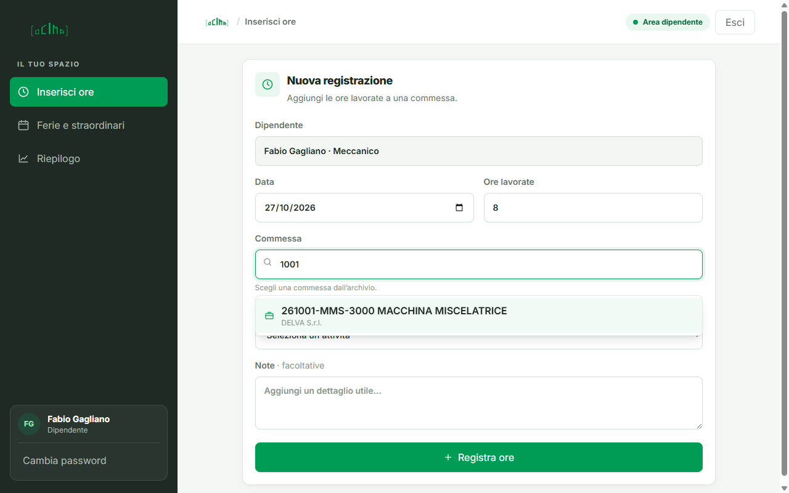

3. **Attività**: scegli l'attività tra quelle previste per il tuo reparto.
4. **Note** (facoltative): aggiungi un dettaglio utile.
5. Premi **Registra ore**.

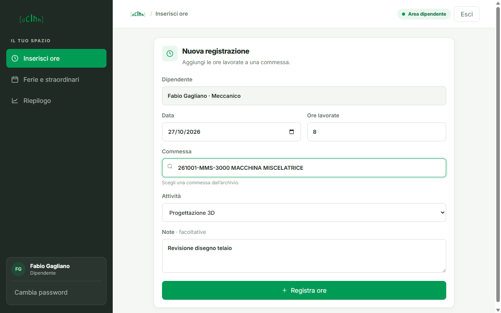

### 3.2 Ferie e straordinari

Il dipendente **non deve chiedere nessuna autorizzazione**: inserisce direttamente le proprie ferie, permessi, ore in più o giorni di malattia e la registrazione viene salvata subito.

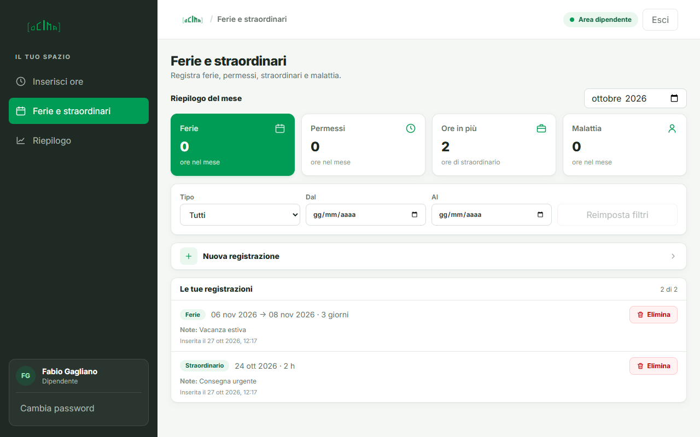

- In alto trovi il **riepilogo del mese**: ore di ferie, permessi, ore in più e malattia.
- **Nuova registrazione** apre il modulo: scegli il tipo, le date (ferie e malattia contano 8 ore per giorno lavorativo) oppure le ore (permessi e straordinari) e le note.
- Con i filtri **Tipo**, **Dal** e **Al** puoi cercare nelle tue registrazioni; **Reimposta filtri** li azzera.
- Il pulsante rosso **Elimina** cancella una registrazione inserita per errore.

### 3.3 Riepilogo

Mostra le ore del mese e l'elenco delle tue registrazioni.

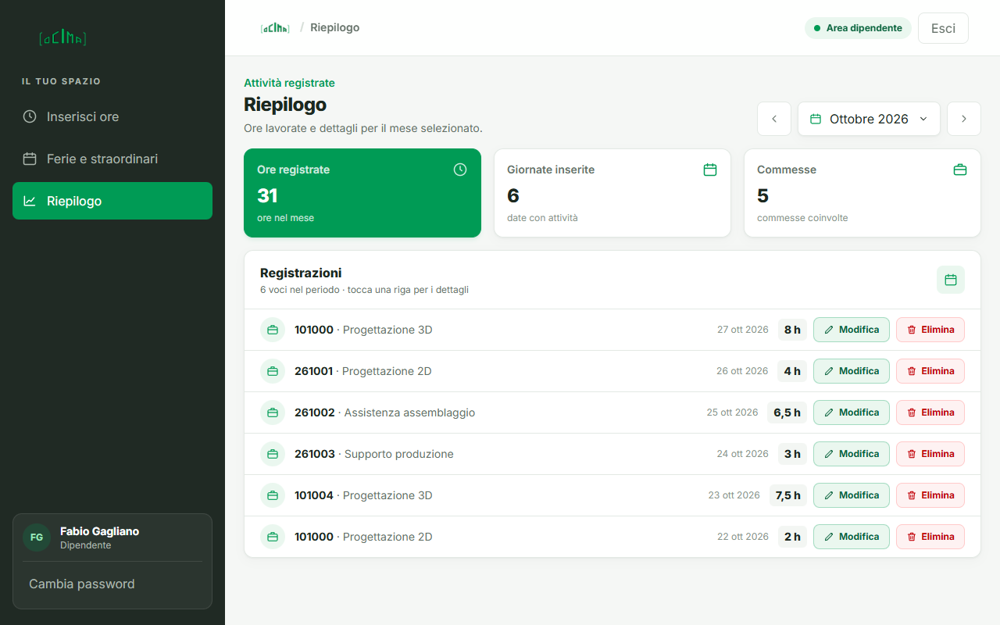

- Le frecce e il selettore in alto cambiano **mese**.
- Ogni riga è su **una sola linea**: commessa, attività, data, ore e i pulsanti **Modifica** ed **Elimina**.
- Clicca su una riga per aprire il **dettaglio completo** (data, ore, commessa, attività, note, quando è stata registrata).

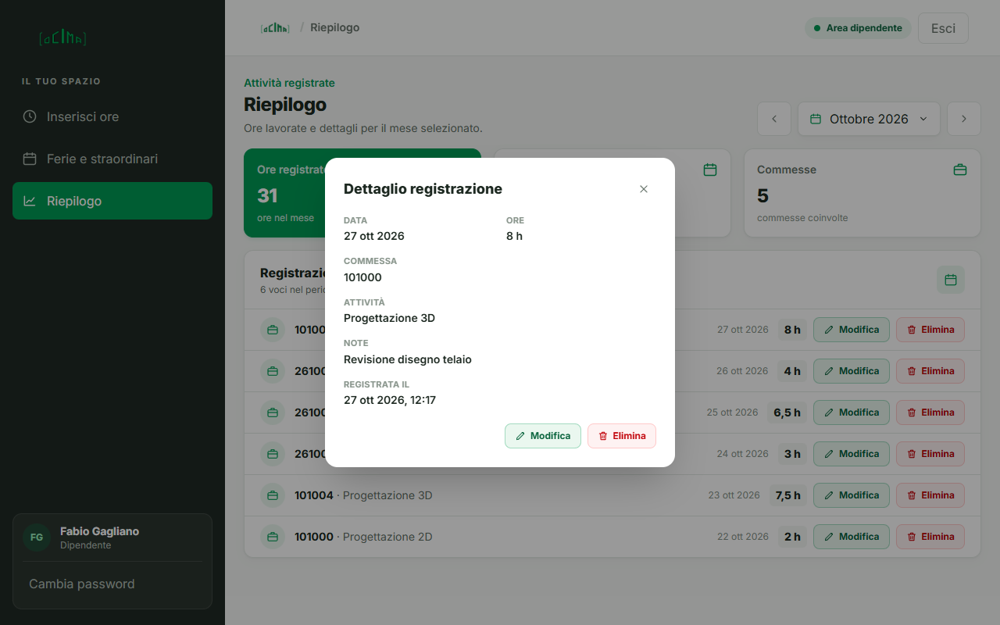

Dal dettaglio puoi anche **Modificare** o **Eliminare** la registrazione. Ogni dipendente può modificare solo le proprie.

---

## 4. Guida per l'amministratore

L'amministratore vede tutto. Il menu è diviso in due gruppi: **Gestionale** e **Analisi**.

### 4.1 Gestione dipendenti

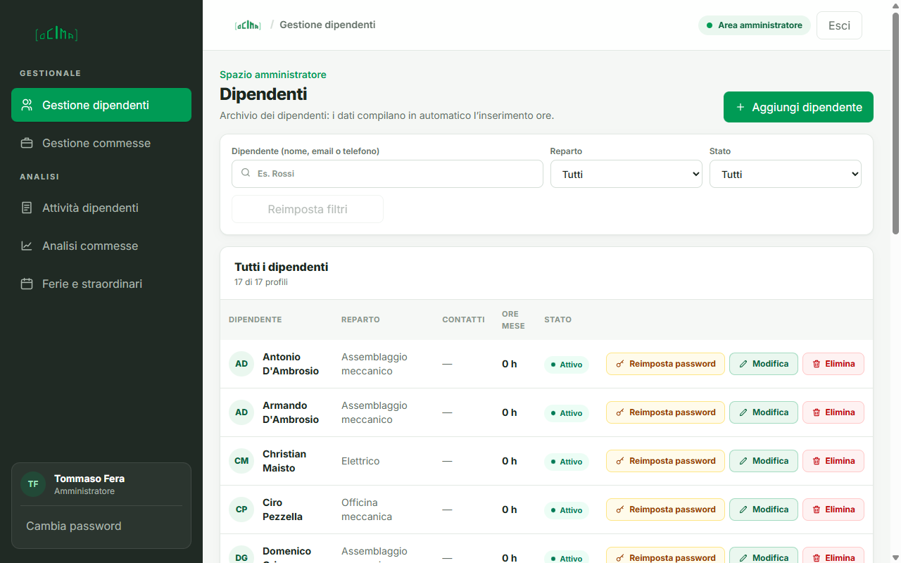

- **Aggiungi dipendente**: nome, reparto, e-mail, telefono e stato. Il nuovo dipendente riceve la password iniziale.
- Filtra per nome, **Reparto** o **Stato** (*Attivo*, *In ferie*, *Inattivo*).
- Pulsanti di ogni riga:
  - **Reimposta password** (arancione): riporta la password a quella iniziale; il dipendente dovrà sceglierne una nuova al prossimo accesso. Se un dipendente ha chiesto il reset, compare l'avviso «Reset password richiesto».
  - **Modifica** (verde): cambia i dati del dipendente.
  - **Elimina** (rosso): rimuove il dipendente. Chi ha già registrato ore non si può eliminare: imposta lo stato **Inattivo** (non comparirà più nell'elenco di accesso).

### 4.2 Gestione commesse

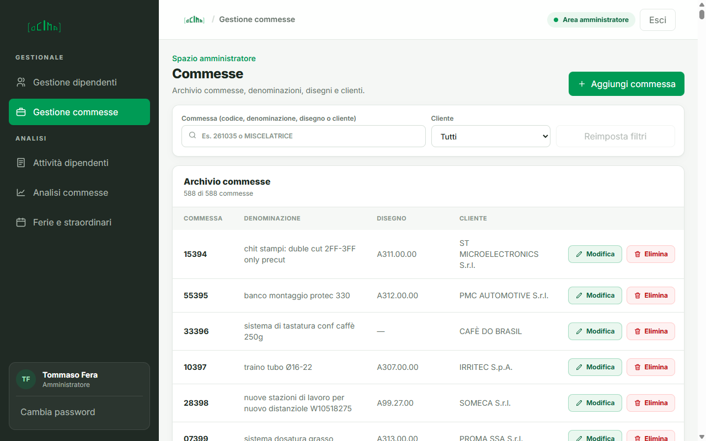

L'archivio delle commesse è usato dai dipendenti quando inseriscono le ore. Puoi **cercare** per codice, denominazione, disegno o cliente, filtrare per **Cliente**, **aggiungere**, **modificare** ed **eliminare** (ogni commessa è su una sola riga). Le commesse sono mostrate come codice cliente + numero commessa (esempio `261035`).

### 4.3 Attività dipendenti

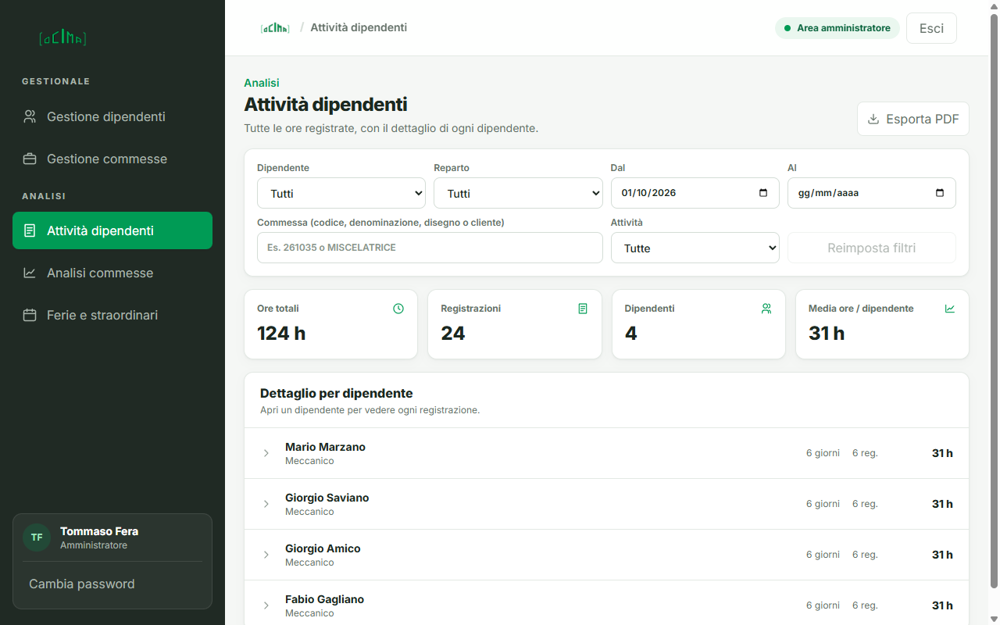

Tutte le ore registrate, con filtri per **dipendente**, **reparto**, **periodo**, **commessa** e **attività**, e i totali (ore totali, registrazioni, dipendenti, media). Clicca su un dipendente per vedere ogni singola registrazione.

Il pulsante **Esporta PDF** crea un documento PDF ordinato con i dati filtrati, pronto da stampare o inviare. Non è prevista l'esportazione in Excel o CSV.

### 4.4 Analisi commesse

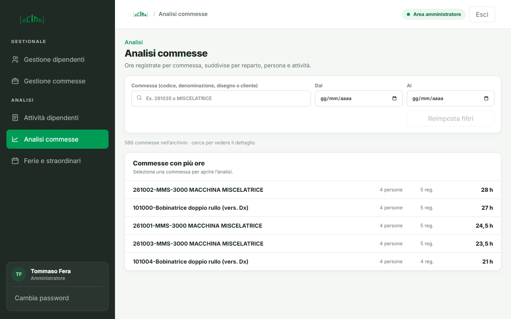

Mostra le ore registrate per commessa, suddivise per reparto, persona e attività. Senza ricerca vedi le commesse con più ore; cercandone una (o cliccandola) si apre l'analisi dettagliata. Anche qui puoi filtrare per periodo ed esportare in PDF.

### 4.5 Ferie e straordinari

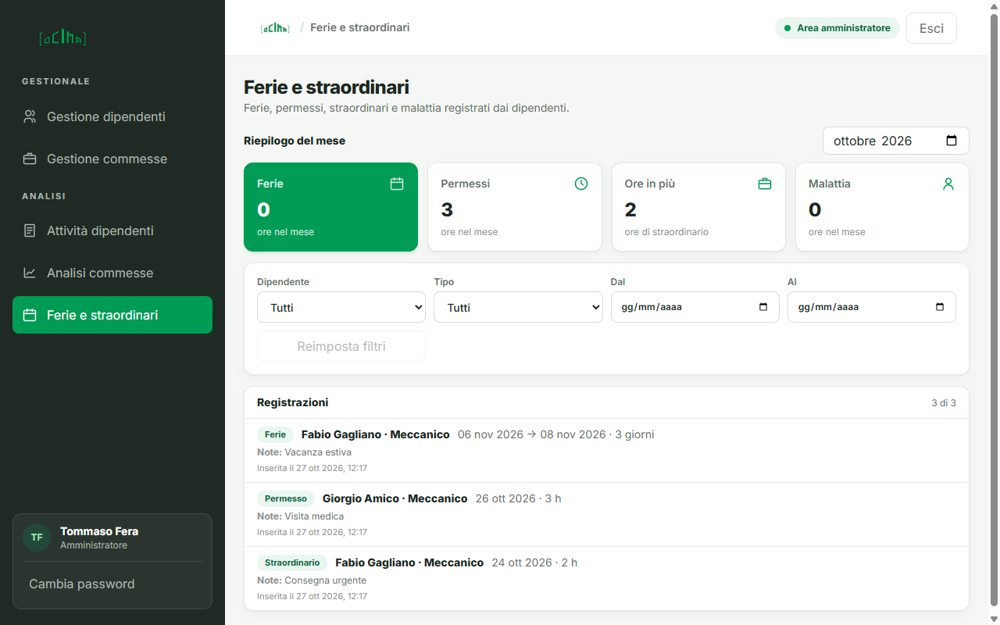

Elenco di tutte le ferie, i permessi, gli straordinari e le malattie inseriti dai dipendenti, con riepilogo mensile e filtri per **dipendente**, **tipo** e **periodo**. L'amministratore consulta i dati: non c'è nessuna approvazione da dare.

---

## 5. Usare l'app da telefono e codice QR

L'app, una volta avviata sul computer, è raggiungibile da qualsiasi telefono o tablet collegato **alla stessa rete Wi-Fi**, sulla porta **3001**.

1. Avvia **Ocima Ore** sul computer e lascialo acceso.
2. Trova l'indirizzo IP del computer: apri PowerShell e scrivi `ipconfig`; usa l'indirizzo della scheda **Wi-Fi** (esempio `192.168.1.72`). Non usare quello del telefono.
3. Sul telefono apri il browser e vai su `http://192.168.1.72:3001` (con il **tuo** IP).
4. **Solo la prima volta**, consenti l'app nel firewall di Windows. Apri PowerShell **come amministratore** ed esegui:

   ```powershell
   New-NetFirewallRule -DisplayName "Ocima Ore" -Direction Inbound -Protocol TCP -LocalPort 3001 -Action Allow -Profile Private
   ```

   Se la rete Wi-Fi è impostata come «Pubblica», cambiala in «Privata» nelle impostazioni di Windows.

### Codice QR

Per far entrare i dipendenti con una semplice scansione, crea un QR code con l'indirizzo `http://<IP del computer>:3001`:

- da una copia del progetto: `npm run qr` stampa il QR nel terminale e salva l'immagine **`ocima-qr.png`**;
- oppure con qualsiasi generatore di QR code online, inserendo l'indirizzo.

Stampa il QR e appendilo in ufficio: inquadrandolo con la fotocamera si apre la pagina di accesso di Ocima Ore, dove ognuno sceglie il proprio nome e inserisce i propri dati. L'interfaccia si adatta da sola a telefono, tablet e computer.

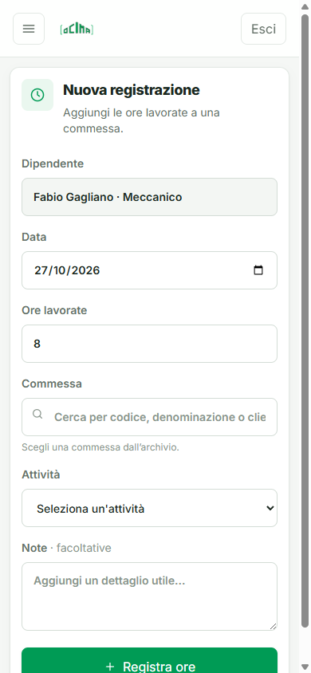

Sul telefono il menu si apre con il pulsante in alto a sinistra:

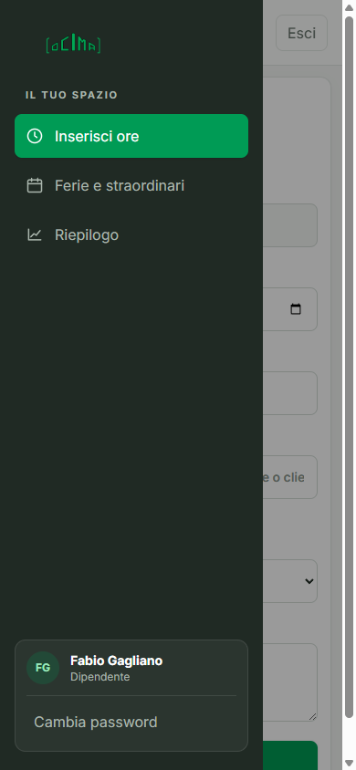

> L'indirizzo funziona solo finché il computer è acceso con l'app aperta e solo dentro la stessa rete. Se il router assegna un IP diverso al computer, il QR va rigenerato (conviene riservare un IP fisso al computer nel router).

---

## 6. Dove sono i dati e come fare una copia

I dati sono in cinque file SQLite sul computer:

`%APPDATA%\ocima.resource.node\data\databases\`

| File | Contenuto |
|---|---|
| `commesse.sqlite` | archivio commesse |
| `time-entries.sqlite` | ore registrate |
| `employees.sqlite` | dipendenti |
| `administrators.sqlite` | amministratori |
| `leave.sqlite` | ferie, permessi, straordinari, malattie |

Accanto a ogni file possono comparire `-wal` e `-shm`: sono file di servizio di SQLite, normali, che si uniscono al file principale quando l'app si chiude.

**Copia di sicurezza:** chiudi l'app e copia l'intera cartella `data` su una chiavetta o un disco di rete. Per ripristinare, richiudi l'app e rimetti la cartella al suo posto.

**Azzerare tutto:** chiudi l'app e cancella la cartella `data`. Al prossimo avvio vengono ricreati dipendenti, amministratori e commesse iniziali, senza ore registrate.

---

## 7. Problemi frequenti

| Problema | Cosa fare |
|---|---|
| L'app si apre e si chiude subito | Reinstalla con l'ultima versione dell'installer. Se compare una finestra con un errore, invia il testo a chi gestisce l'app. |
| Dal telefono la pagina non si apre | Controlla che telefono e computer siano sulla **stessa rete Wi-Fi**, che l'app sia aperta sul computer, che l'IP sia quello della scheda Wi-Fi e che la regola del firewall (punto 5) sia stata creata. |
| «Password non corretta» | Controlla maiuscole e minuscole con l'icona a forma di occhio. Se l'hai dimenticata usa **Password dimenticata?** e chiedi all'amministratore di reimpostarla. |
| Non trovo il mio nome nell'elenco | Chiedi all'amministratore di verificare che il tuo stato non sia **Inattivo**. |
| Non riesco a eliminare un dipendente | Ha già ore registrate: imposta lo stato **Inattivo**. |
| La porta 3001 è occupata | Chiudi altre copie di Ocima Ore; se resta occupata, l'app sceglie automaticamente un'altra porta (in questo caso il QR non è più valido). |
